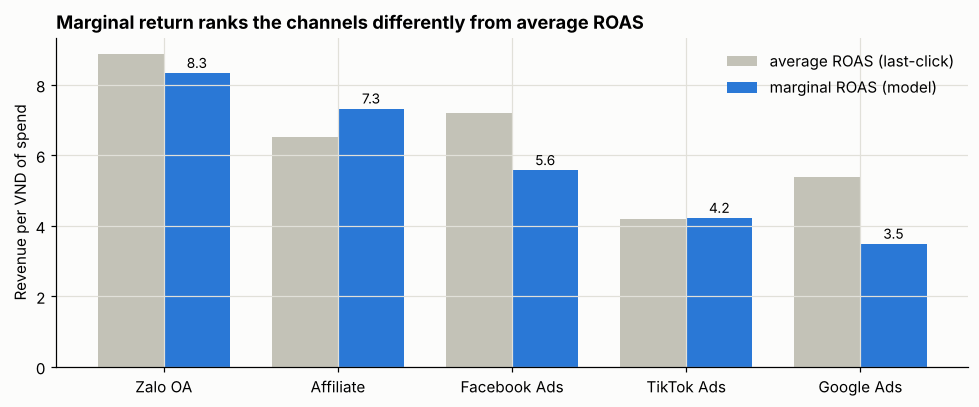

# Marketing Analytics in Python — EDA, A/B testing, hypothesis tests, marketing-mix regression

[](requirements.txt)
[](requirements.txt)
[](https://github.com/Hakian14/marketing-analytics-python/actions/workflows/tests.yml)
[](LICENSE)

Four notebooks that take marketing questions from "what happened" to "what should we do", each
one picking the statistical tool the question actually needs and reporting **effect sizes and
confidence intervals, not just p-values**. The statistics are implemented transparently in
[`src/stats_utils.py`](src/stats_utils.py) (numpy/scipy, unit-tested) so every number can be traced.

This is where my Statistics degree meets five years of commercial analytics. The data is synthetic
(seeded, [`data/generate_data.py`](data/generate_data.py)) so it can be shared; the questions are
the ones marketing and product teams actually ask.

| # | Notebook | Question | Methods | Headline |
|---|---|---|---|---|
| 01 | [EDA: paid-media performance](notebooks/01_eda_campaign_performance.ipynb) | Where did 20B VND of media spend go and what came back? | Funnel metrics (CTR/CVR/CPA/ROAS), spend-quintile analysis, seasonality | CPA in the top spend quintile is 1.3–1.7× the bottom — diminishing returns on every channel. TikTok's weak ROAS hides a 74% new-customer share. |
| 02 | [A/B test: checkout redesign](notebooks/02_ab_test_checkout_redesign.ipynb) | Does the new checkout convert better? | Power analysis, SRM check, two-proportion z-test, bootstrap CI, Mann-Whitney, Bonferroni-adjusted segments, novelty check | **+15.9% conversion (p = 0.006)** — but the entire lift is in returning users; new users unchanged. Ship, and treat new-user checkout as a separate problem. |
| 03 | [Hypothesis testing: promotions](notebooks/03_hypothesis_testing_promotions.ipynb) | What do promotions actually change? | Welch's t-test + Cohen's d, χ² + Cramér's V, ANOVA + Levene + Kruskal-Wallis, Bonferroni post-hoc, Spearman | Free shipping lifts order value +12% (pays for itself ~2×). Promo type's effect on repeat purchase is significant but trivial (V = 0.045); channel matters 3× more. |
| 04 | [Regression: marketing mix](notebooks/04_regression_marketing_mix.ipynb) | What does the *next* VND of spend return? | Log-log OLS with ad-stock (decay fitted by coordinate descent), Fourier seasonality, VIF, Durbin-Watson, marginal ROAS, budget scenario | Zalo OA has the highest marginal ROAS (8.3) and the smallest budget; Google the lowest (3.5). Shifting 15% of Google to Zalo predicts +1.3% revenue at equal spend. |



## How the notebooks are built

The notebooks live as plain Python in [`notebooks/src/`](notebooks/src/) (Jupytext "percent"
format: diff-able, lint-able, runnable as scripts) and are rendered to `.ipynb` **with outputs** by
[`scripts/build_notebooks.py`](scripts/build_notebooks.py), a ~100-line runner that needs no
Jupyter installation. Open the `.ipynb` files on GitHub to read them; run the `.py` files to
reproduce them.

```bash
git clone https://github.com/Hakian14/marketing-analytics-python.git
cd marketing-analytics-python
pip install -r requirements.txt     # pandas, numpy, scipy, matplotlib

python data/generate_data.py        # (optional) regenerate the three datasets - deterministic
python scripts/build_notebooks.py   # execute all four notebooks -> notebooks/*.ipynb
python tests/test_stats_utils.py    # or: python -m pytest
```

Or open any `notebooks/src/*.py` in VS Code / Jupyter — the `# %%` cell markers are recognised natively.

## What's in `src/stats_utils.py`

| Function | Mirrors | Used in |
|---|---|---|
| `two_proportion_ztest` | `statsmodels.stats.proportion.proportions_ztest` + Wald CI | 02 |
| `sample_size_two_proportions` | standard two-arm power calculation | 02 |
| `srm_check` | χ² goodness-of-fit for sample-ratio mismatch | 02 |
| `welch_ttest` | `scipy.stats.ttest_ind(equal_var=False)` + CI + Cohen's d | 03 |
| `bootstrap_ci`, `bootstrap_diff_ci` | percentile bootstrap | 02, 03 |
| `pairwise_welch_bonferroni` | post-hoc after ANOVA | 03 |
| `ols`, `vif` | `statsmodels.OLS` summary table; `variance_inflation_factor` | 04 |
| `adstock` | geometric ad-stock transform | 04 |

All of it is tested in [`tests/test_stats_utils.py`](tests/test_stats_utils.py) against closed-form
values or scipy on the same data.

## Datasets

| File | Rows | Grain | Used by |
|---|---|---|---|
| `data/raw/campaign_daily.csv` | 2,190 | channel × day, 2025 | 01, 04 |
| `data/raw/ab_test_checkout.csv` | 40,000 | exposed user | 02 |
| `data/raw/orders_promotions.csv` | 15,000 | order | 03 |

The generator encodes the effects the notebooks are meant to find (diminishing returns, a lift
concentrated in returning users, a free-shipping basket effect, regional differences) with realistic
noise, so the exercise is detecting and *sizing* them correctly rather than knowing they exist.

## Repository layout

```
├── data/
│   ├── generate_data.py            # seeded synthetic data
│   └── raw/                        # 3 CSVs
├── notebooks/
│   ├── 01…04_*.ipynb               # rendered, with outputs - read these
│   └── src/01…04_*.py              # the source of each notebook
├── src/stats_utils.py              # statistics helpers (numpy/scipy)
├── scripts/build_notebooks.py      # .py -> executed .ipynb
├── tests/test_stats_utils.py
└── docs/                           # figures used in this README
```

## About

Built by **Ha Kieu Anh** — B.Sc. Statistics (National Economics University), Data Analyst with 5+
years in e-commerce, retail and CRM analytics, now also working in AI training & evaluation.
[GitHub](https://github.com/Hakian14) · [LinkedIn](https://www.linkedin.com/in/kieu-anh-ha-6249a3172/) · hakieuanh662@gmail.com

License: [MIT](LICENSE)
